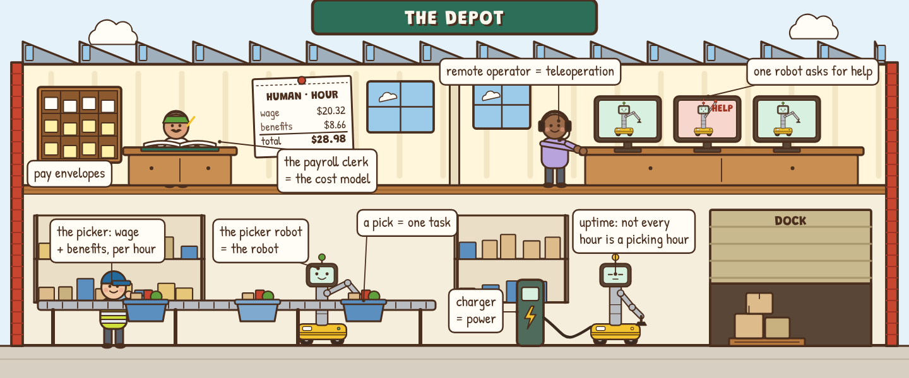
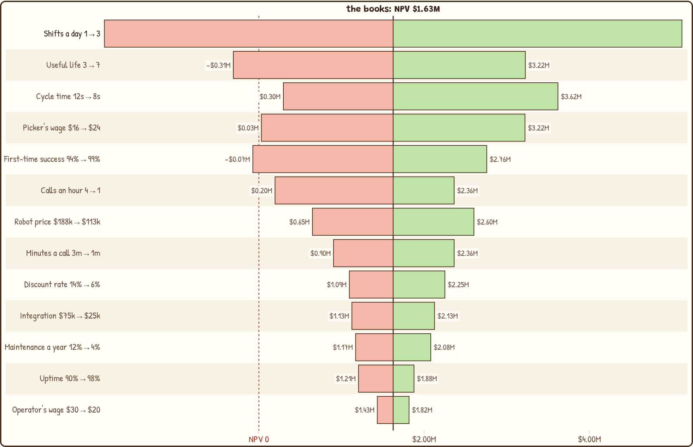

# Robot Payroll

**A hands-on lab for the business of deploying robots: when does a robot actually beat a human shift, and what has to be true?** The Depot, a Busytown warehouse, has a payroll office that pays its pickers and its robots side by side. Price one good pick for each, then find out what autonomy, remote operators, a learning curve, a fleet and a pitch deck do to that number.

**Play it: https://aistacked.netlify.app/robot-payroll/**

*Step 2 in motion: a call every 3.5 minutes costs 23¢ a good pick, against the picker's 9.95¢; a call every 100 hours, 7.07¢. The default, every 30 minutes, is 8.23¢.*

*The tornado in step 4: shifts a day and useful life swing the fleet's NPV more than the robot's price does.*

The **picker** is a human shift, paid per hour worked: wage plus benefits. The **picker robot** is paid for per year and used per hour. The **payroll clerk** is the cost model, and every line on its payslips is an assumption you can change. A **pick** is one task, and both are judged on what one *good* pick costs. A **call for help** is an intervention, answered at the **remote desk** by teleoperation; the **lesson book** is the training data those calls become; the **ledger** is the deal; the **spares cage** and the queue at the remote desk are the fleet; and the **pie** is the saving, which everyone gets a slice of before the customer does.

## What's inside

| Step | You play with | What clicks |
|---|---|---|
| **0 · Payroll Office** | The picker's payslip: BLS wage, BLS benefits load, picks per hour | A $20.32 wage is a $28.98 hour, and with rework 9.95¢ a good pick. That's the number to beat |
| **1 · Cost per Pick** | The robot's payslip next to the human's; shifts, price, integration, life, uptime, cycle time, success; cost per pick against hours a year | 8.23¢ at two shifts, 13.91¢ at one: utilisation before price. Rework of missed picks ($4.65 an hour) costs more than the remote operator; power is 8¢ |
| **2 · Remote Desk** | MTBI on a log slider, minutes per call, operator occupancy; ratio set by the workload or by contract; the "last 5%" table | 99.44% autonomous per pick is 2 calls an hour and one operator per 11.25 robots. 95% autonomy costs 23.8¢ a pick; 99.9% costs 7.13¢; past that the curve is flat |
| **3 · The Flywheel** | A transparent toy learning curve: calls fall by a share per doubling of the vendor's fleet hours (Wright's 1936 curve, by analogy) | Interventions are training data (DAgger, human-in-the-loop). A robot that loses at 6 calls an hour wins from month 12; early doublings are fast, later ones slow |
| **4 · The Ledger** | A fleet of 20: payback, NPV, IRR, buy vs RaaS, a learning toggle, break-even wages, a tornado of 13 assumptions | Payback 32 months, NPV $1.63M, IRR 24.9%. Shifts and useful life swing NPV most. Break-even wage $16.18, and it's the same number for NPV = 0 |
| **5 · The Fleet** | Robots and operators sharing a remote desk as an M/M/c queue (Erlang C, solved with the call rate), the exact finite-population cross-check, pooling, binomial spares | Two operators for 20 robots: a minute's wait per call; one: 12 minutes, and the robot loses. Same 1:10 ratio, 10 robots wait 147 s, 100 robots wait 3 s. Twenty robots at 95% uptime are all up 36% of the time |
| **6 · Who Gets the Saving** | One robot-year of replaced payroll split between the customer, the robot maker, the integrator, operators, rework, power and the cost of money; a diligence checklist with an exact Poisson range on MTBI | The Depot keeps 17% of $123,780. The robot's price ceiling is set by the payroll ($212,360), so pricing power lives in uptime, success and autonomy. "MTBI 8 h" from 120 hours means 4.9–14.3 h |
| **★ Review Board** | Three fictional pitch decks, each with one wrong line: run the deck's own sheet, pick the fix, re-run, diagnose | "Payback in 9 months" forgot the operators its own pilot needs (honest: about 50 months). "One operator, 50 robots" is 750% busy. "$11 an hour vs $29" is 23% dearer per good pick |
| **✓ Field Test** | Ten numeric questions answered by operating the widgets | Proof it stuck |

Every step has predict-then-reveal questions and a "say it out loud" line that unlocks once you've played. Every term has a tooltip with its plain meaning and its Depot equivalent. Every assumption has a slider, a source chip (BLS, EIA, illustrative, toy) and a home in **the books** (step 1); change one and every step follows, with a banner saying what you changed. Progress is saved in your browser.

## Why this one

Robot economics usually arrive as a vendor ROI calculator (one robot, no interventions, a payback number) or as a slide with "99% autonomous" on it. Neither shows the arithmetic that decides a deployment: cost per *good* task, the hours the robot is actually used, what autonomy below 100% costs in operator time, how calls queue when operators are shared, and who the saving goes to. This lab puts all of it on one set of books you can edit, built for the person who has to say yes: a COO, an investor, a founder. It doesn't teach how robots learn ([Demos to Deployment](https://bakulbadwal.github.io/arm-playground/demos-to-deployment/) does) or GPU and compute economics ([Inference Kitchen](https://bakulbadwal.github.io/inference-kitchen/), [Compute Deal Desk](https://bakulbadwal.github.io/compute-deal-desk/)).

## Run it

Play it live at the link above, or open `index.html` in a browser. There's no build step, no dependencies and nothing to install. `node tests/check.js` checks the arithmetic against hand-computed cases and known values, checks the model's directions, holds every number quoted on the page to the model, and prints everything in [`ACCEPTANCE.md`](ACCEPTANCE.md) (under a second).

## What's exact, what's sourced, and what's a model

- **Exact arithmetic:** the capital recovery factor, NPV, IRR and payback; break-even wages by bisection; Erlang C from Erlang B by the standard recursion and the M/M/c wait; the exact finite-population (machine-repair) queue as a cross-check; binomial spares; the exact (Garwood) Poisson interval. All in `js/core.js` as pure functions, all tested.
- **Sourced defaults (dated in [`SOURCES.md`](SOURCES.md)):** the picker's wage (BLS OEWS May 2025, SOC 53-7062, national mean, $20.32), the benefits load (BLS ECEC December 2025, private industry, 42.6%), electricity (EIA, 2024 industrial average, 8.13¢/kWh).
- **Illustrative assumptions, labelled on every slider:** every robot number (price, integration, life, upkeep, power draw, uptime, cycle time, success, interventions, minutes per intervention), the human's picks per hour and accuracy, rework, the operator's wage, the discount rate, the RaaS fee and the margins. No company's private numbers are used; the three decks are fictional. Public list prices appear only as anchors in SOURCES.md.
- **Teaching models, labelled on the page:** the learning curve is a toy (Wright-style, by analogy). The queue assumes random arrivals and service; Erlang C assumes endless callers, so it overstates waits for small fleets, and the page shows the exact finite-population figure beside it. Cash flows are yearly and pre-tax, with no residual value, ramp-up or inflation. Human labour is treated as divisible into the hours the robot replaces; real staffing has minimum shifts, overtime, hiring and turnover the model leaves out.

## Modelling conventions worth knowing

- Cash flows are end-of-year with the outlay at year 0; the RaaS fee is charged the same way, as a year-end amount. Paid monthly in advance it would cut RaaS's NPV by a few percent, so the toggle flatters RaaS slightly.
- Remote operators are paid the picker's wage with the same 42.6% benefits load (BLS ECEC private industry).
- Spare robots (step 5) are costed separately and sit outside the deal NPV and the robot's price ceiling.
- The finite-population cross-check in step 5 treats each robot's call rate as λ × uptime, an approximation.
- Deck A's "fully autonomous" NPV is reported as the deck pitches it; the review board's job is to take it apart.

## Sources

- U.S. Bureau of Labor Statistics, [Occupational Employment and Wage Statistics, 53-7062](https://www.bls.gov/oes/current/oes537062.htm) (May 2025) and [Employer Costs for Employee Compensation](https://www.bls.gov/news.release/ecec.htm) (December 2025)
- U.S. Energy Information Administration, [Electric Power Annual](https://www.eia.gov/electricity/annual/) (2024 data)
- International Federation of Robotics, [World Robotics 2025](https://ifr.org/ifr-press-releases/news/service-robots-see-global-growth-boom) (context: service robots and RaaS)
- T. P. Wright, "Factors Affecting the Cost of Airplanes" (1936): the learning-curve analogy
- Ross, Gordon & Bagnell, [DAgger](https://arxiv.org/abs/1011.0686) (2011): why interventions are training data
- A. K. Erlang (1917); F. Garwood (1936): Erlang C and the exact Poisson interval

## The series

[Inference Kitchen](https://bakulbadwal.github.io/inference-kitchen/) (serving economics) · [Compute Deal Desk](https://bakulbadwal.github.io/compute-deal-desk/) (compute deals) · [Arm Playground](https://bakulbadwal.github.io/arm-playground/) (kinematics and control) · [Demos to Deployment](https://bakulbadwal.github.io/arm-playground/demos-to-deployment/) (imitation learning) · **Robot Payroll** (the business of deploying robots)

MIT licensed. Built by [Bakul Badwal](https://www.linkedin.com/in/bakulbadwal/) with Claude Code.
